# Lab report items 3 + 4: sidenav collapse button, invisible "User guides" / "Logout" (2026-10-29)

Scope: reproduce, root-cause and prototype fixes for two UI bugs a lab reported on the PHP 8 / Bootstrap 5 build (`claude/eloquent-davinci-l30490`). The lab runs Ubuntu 24.04, PHP 8.4 (FPM), Apache 2 and MariaDB, with the modern UI turned on. Both features worked on `develop` (Bootstrap 4, PHP 7).

Prototype branch: `claude/scope-bs5-nav-issues` (on top of `claude/eloquent-davinci-l30490`). The diff is 4 files and about 25 lines.

## How it was tested

- **Stack:** PHP 8.3 CLI server (`php -S`, `error_reporting=E_ALL`) and MariaDB 10.11. A fresh DB `testlab` was created by logging in as root.
- **User:** `labuser` ("Write access" preset), created through `edit.php?table=person`. The modern UI is on (it is the default).
- **Browser:** headless Chromium via Playwright, at viewport widths 1600, 1280 and 1000 px. Console errors and page errors were collected from every frame.
- **Classic UI:** checked by setting `use_bootstrap4` to 0 in `global_settings`.
- **Framesets checked:** `main.php` (inventory) and `lj_main.php` (lab journal). Both load the sidenav with the same collapse toggle.

The PHP 8.3 vs 8.4 difference does not matter here: both bugs are client-side (JS and CSS only).

---

## Bug 3: the collapse button only works once

> The "collapse" button at the top left of the screen doesn't work properly. Before clicking it the sidenav is normal; after clicking it, the left section becomes tiny. But then clicking the button again does nothing. […] dragging […] clicking the collapse button still doesn't have any functionality.

### Reproduced

| Step | `<frameset id="sideframe">` cols | Topnav `»` button (`#expand-icon`) |
|---|---|---|
| Initial | `262,*` | hidden |
| Click the sidenav toggle | `35,*,0` (a 35 px strip) | hidden |
| Click the toggle again (it is still visible in the strip) | `35,*,0`, no change | hidden |
| Click it 3 more times | `35,*,0` | hidden |

The result is the same at all three widths and in the lab journal (`275,*,0` → `35,*,0`, then stuck). The classic UI is stuck the same way. No JS errors are raised: the click runs, but it does nothing.

| Before: after the 1st click | Before: after the 2nd click |
|---|---|
| 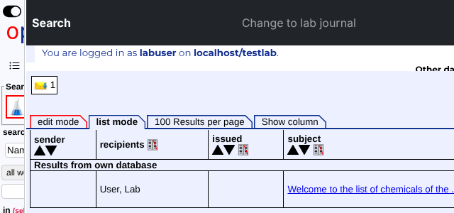 |  |

### Root cause

The collapse toggle is in `sidenav.php:228`. Its handler is hard-coded to `switchSideframe(false)`, so it can only ever collapse.

On `develop` that was fine, because there was a separate way back:

1. The fork's `lib/sidenav.js` collapsed the frame to **0** px (`fs_obj.cols="0,*,0"`).
2. The topnav's resize listener (`topnav.php:451`, unchanged from `develop`) shows the `»` `#expand-icon` button only when `sidenav.scrollWidth == 0`.
3. That button calls `switchSideframe(true)`.

On this branch, **`lib/sidenav.js:43` collapses to 35 px again** (`fs_obj.cols="35,*,0"`). That is Felix's value. The merge of Felix OE-2022-02-20 (`1d5eb42`, step A) took Felix's `lib/sidenav.js` wholesale and dropped all of the fork's edits to it (`git diff 1d5eb42^1 1d5eb42 -- lib/sidenav.js`). As a result:

- the sidenav ends up 35 px wide, never 0, so the `»` button in the topnav never appears;
- the toggle is still visible in the 35 px strip, but it only collapses;
- Felix's own expand button in the strip (`id="expand"`, toggled by the `visibleObj("expand",…)` calls) was commented out in the fork's `sidenav.php:1295-1297`, so nothing can expand the sidenav again.

This is not a Bootstrap 4 → 5 rename problem. The `data-bs-toggle="collapse"` on `#expand-icon` has no target and plays no part in it.

### Fix (prototype)

Make the sidenav toggle an actual toggle. It is visible in the 35 px strip in every frameset, so this also covers the lab journal, the literature frameset and the classic UI. None of those have a topnav `»` button, so restoring the fork's 0 px collapse would leave them with no way to expand the sidenav.

- **`lib/sidenav.js`:**
  - New `toggleSideframe()`, which calls `switchSideframe(fs_obj.cols!=top.fs_obj_orig)`.
  - `switchSideframe()` now flips the toggle icon between `bi-toggle-on` and `bi-toggle-off`, so the button shows its state. The icon is looked up through the sidenav frame, because the topnav's `»` span also has `id="collapse-icon"`.
- **`sidenav.php:228`:** the toggle's handler changes from `switchSideframe(false)` to `toggleSideframe()`.
- **`topnav.php` resize listener:** return early when `#expand-icon` is missing.
  - The classic topnav has no `#expand-icon`. The listener already threw `Cannot read properties of null (reading 'style')` once per page load there. With a working toggle it would throw on every collapse and expand.
  - Behaviour is unchanged in the BS5 UI.

The topnav `»` path still works: when the user drags the sidenav to 0 px, `»` appears, and clicking it restores `262,*` (verified).

### Verified (after the fix)

| UI / frameset | Toggle clicked 4× | Console errors |
|---|---|---|
| BS5, `main.php`, at 1600, 1280 and 1000 px | `262,*` → `35,*,0` → `262,*` → `35,*,0` → `262,*`; icon goes off/on/off/on | 0 |
| BS5, `lj_main.php` | `275,*,0` → `35,*,0` → `275,*,0` → `35,*,0` → `275,*,0` | 0 (DYMO probe excluded) |
| BS5, sidenav dragged to 0 px | `»` visible; clicking it gives `262,*` | 0 |
| Classic, `main.php` and `lj_main.php` | same toggling | 0 (was 1 before) |

| After: collapsed (toggle shows "off") | After: 2nd click expands again |
|---|---|
| 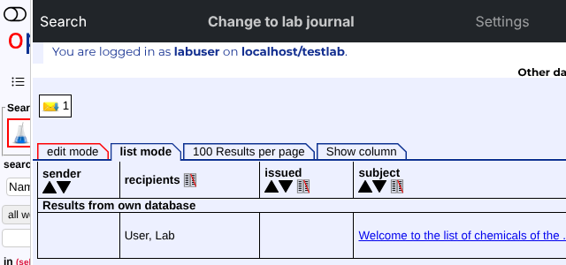 | 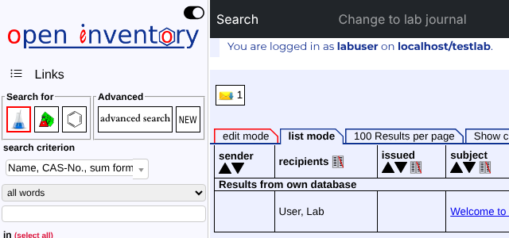 |

---

## Bug 4: "User guides" and "Logout" are white text off the black bar

> The "User guide" and "Logout" buttons at the top right of the screen are now almost invisible, since they are in white text that no longer sits on the black background.

### Reproduced

Measured in the topnav frame (the frame is 1336 px wide at a 1600 px viewport, and 1016 px wide at 1280):

| Viewport | `nav.navbar` box | `a.user_guide` x-position | Background behind the link | Link colour (`navbar-dark`) | Contrast |
|---|---|---|---|---|---|
| 1600 | 0–1336 | **1336**–1403 | page `rgb(237,240,255)` | `rgba(255,255,255,.55)` | **1.07 : 1** |
| 1280 | 0–1016 | **1016**–1083 | page `rgb(237,240,255)` | same | **1.07 : 1** |

The links start exactly where the dark bar ends. They render in white on the light page background, partly cut off on the right edge of the frame, and the frame gets a horizontal overflow (`scrollWidth` 1471 > 1336).

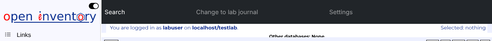

### Root cause

At `topnav.php:183` the left-hand menu is `<ul class="navbar-nav me-auto col-8 nav-fill w-100">`. Bootstrap 4 and Bootstrap 5 handle these classes differently:

| | `.col-8` | Result with `.w-100` (`width:100% !important`) |
|---|---|---|
| Bootstrap 4.3 | `flex: 0 0 66.67%; max-width: 66.67%` | `max-width` caps the width at 66.67%. `w-100` had no effect, and the right-hand `<ul class="ms-auto">` fit next to it. |
| Bootstrap 5.3 | `flex: 0 0 auto; width: 66.67%` (no `max-width`) | `w-100` wins, so the left `<ul>` is 100% wide and cannot shrink (`flex-shrink: 0`). The right `<ul>` is pushed outside the bar. |

Measured: the left `<ul>` is 1336 px wide (100%), and the right `<ul>` starts at x = 1336.

### Fix (prototype)

`topnav.php:183`: drop `w-100`. This restores the Bootstrap 4 layout exactly: the left menu takes 66.67%, and `ms-auto` pins "User guides" and "Logout" to the right end of the bar. The classic UI does not use this code path.

### Verified (after the fix)

| Viewport | Links' x-position | Inside the bar | Background | Contrast |
|---|---|---|---|---|
| 1600 | 1160–1336 | yes | `rgb(33,37,41)` (`bg-dark`) | **5.67 : 1** (passes WCAG AA) |
| 1280 | 840–1016 | yes | `rgb(33,37,41)` | **5.67 : 1** |

The bar is also back to one line: it was 64 px tall before the fix, because "User guides" wrapped.

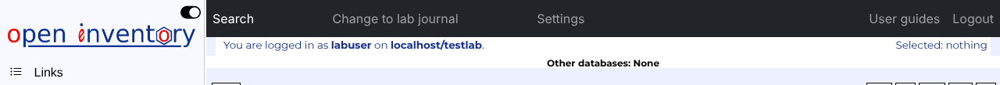

At 1000 px (topnav frame 736 px, below Bootstrap's `md` breakpoint) the links are inside the burger menu, both before and after the fix. Unchanged and pre-existing, the same as on BS4: the opened burger menu is taller than the 100 px topnav frame (`main.php` `rows="100,0,*"`). "User guides" and "Logout" land at y = 160 and 192, so they can only be reached by scrolling inside the topnav frame. That is a separate, optional follow-up.

---

## Does it depend on the customization or the logos? No.

I re-ran both reproductions with MIT's customization:

- `define("customization",".mit")`, plus the `$default_g_settings["customization"]="mit";` line that `origin/mit` adds. Both edits were local to the test and are not committed.
- A fresh DB `testmit` created by root login. It carries MIT's `links_in_topnav`: `lib/mit_logo.png` at 240 px wide, plus the `fb_logo`.
- User `mituser`.

The results match the default customization exactly, at 1600, 1280 and 1000 px:

| | Default customization (`""`) | `.mit` |
|---|---|---|
| Before the fix: link x-position at 1600 px / contrast | 1336 (bar ends at 1336) / 1.07 : 1 | 1336 / 1.07 : 1 |
| Before the fix: toggle | stuck at `35,*,0` | stuck at `35,*,0` |
| After the fix: links / contrast | inside the bar / 5.67 : 1 | inside the bar / 5.67 : 1 |
| After the fix: toggle (`main.php` and `lj_main.php`) | toggles both ways repeatedly | toggles both ways repeatedly |

Why the customization makes no difference:

- **The topnav logos are not rendered in the modern UI.** In the Bootstrap branch of `topnav.php`, `links_in_topnav` is drawn into `<table id="header">`, which the stylesheet hides (`#header {…display: none;}`, `topnav.php:82-90`). The logos cannot change the navbar's width.
- **The sidenav logo is in the other frame.** It sits in the sidenav frame (`#uni_logo`), so it has no effect on the topnav's layout. It only changes what is visible in the 35 px strip after collapsing.

### The lab's exact setup

An admin account shows four left-hand links: "Search | Change to lab journal | Settings | Order system". I tested that as root at a 1900 px viewport:

- **Before the fix:**
  - The bar is 1636 px wide.
  - "User guides" starts at x = 1636 and "Logout" at 1703, both on the light page background (1.07 : 1).
  - The frame scrolls horizontally (`scrollWidth` > `clientWidth`).
  - This matches the lab's description, including the horizontal scrollbar.
- **After the fix:** the links sit at 1460–1636, inside the bar (5.67 : 1).

The horizontal overflow comes from `nav-fill w-100` on the first `<ul>`:

- Under Bootstrap 5 it is 100% of the bar wide and has `flex: 0 0 auto`, so it cannot shrink.
- The second `<ul>` (`ms-auto`) is laid out after it, past the bar's right edge.
- `.navbar-collapse` does not wrap at `md` and above, so that `<ul>` overflows the frame instead of moving to a new line.
- The frame's `scrollWidth` grows by the width of that `<ul>` (1336 → 1471 at a 1600 px viewport).

### Baylor branch

`origin/baylor-university` (still Bootstrap 4) uses `col-6 … nav-fill w-100` for the left `<ul>` and `col-5 nav-fill w-100` for the right one. Under Bootstrap 5 **both** `<ul>`s would be 100% wide, and the right one would overflow in the same way. When that branch is moved to Bootstrap 5, drop `w-100` from both (or replace it with `flex-grow-1`).

---

## Follow-up (2026-10-30): hide the sidebar completely, one button

The lab reported that the sidebar was "not hiding properly when collapse/toggle the menu" and "not smooth scrolling".

### Hiding

The 2026-10-29 fix made the toggle work both ways. But it collapsed the sidebar to Felix's 35 px strip, which shows a clipped piece of the logo and search form ("Sear…"). That strip is neither usable nor hidden. OE's sidebar holds forms, not icons, so it is now hidden completely in the modern UI, with one button that is always in the same place:

| | Before | After |
|---|---|---|
| Collapsed width | `35,*,0` (strip) | `0,*,0` (hidden) |
| Control, inventory | toggle inside the sidebar; a `»` button in the top bar, only shown when the sidebar was dragged to 0 px | one button, sidebar icon (`bi-layout-sidebar`), at the left of the dark top bar, in both states |
| Control, lab journal (no top bar) | toggle inside the sidebar; `»` in the page's bar when width 0 | the same button in the page's own bar (`edit.php`, `list.php`), shown only where there is no top bar |
| State | lost on reload | remembered per user and frameset in `localStorage` (no storage: open), restored before the frames are drawn |
| Accessibility | `<a>` without state | `<button>` with `aria-expanded`, `aria-controls="sidenav"`, title "Hide sidebar" / "Show sidebar"; Enter / Space work; icon contrast 15.4 : 1 on the bar |
| Classic UI | 35 px strip with the toggle in the sidebar | unchanged |

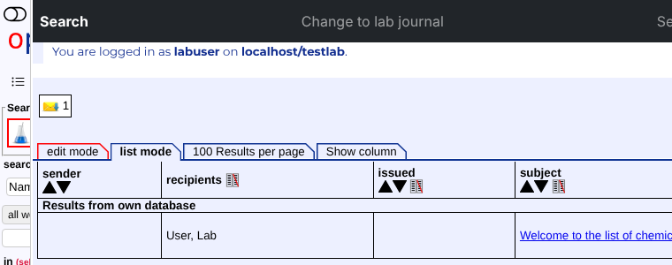
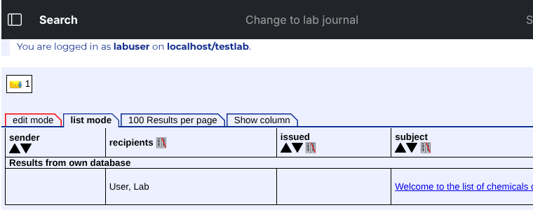
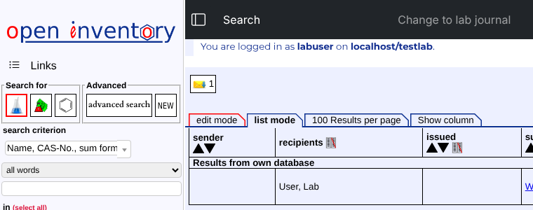
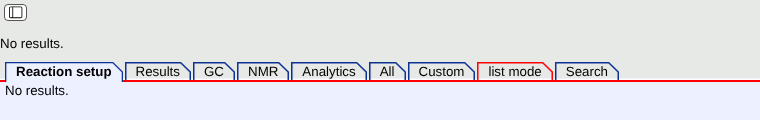

**Code changes:**
- **`lib/sidenav.js`:** new functions `isSideframeOpen()`, `toggleSideframe()`, `saveSideframeState()` and `updateSideframeToggles()`. `isSideframeOpen()` reads the real frame width, not a stored flag, so dragging the border is reflected in the button and in the saved state.
- **`lib_global_funcs.php`:**
  - `getSideframeToggle()` renders the button.
  - `getSideframeStateJS()` gives `main.php`, `lj_main.php` and `lit_main.php` the hidden width and the storage key, and restores a hidden sidebar on `DOMContentLoaded`.
- **Top bar and pages:** `topnav.php`, `edit.php` and `list.php` use the button instead of the old `»` / resize code. `sidenav.php` shows its own toggle only in the classic UI.
- **Strings and style:** new strings `sidenav_hide` / `sidenav_show` (en, de; other languages fall back to English), and the button style in `style.css.php`.
- **No animation:** frames cannot animate smoothly.

**Tested with Playwright.** The inventory (`main.php`) and lab journal (`lj_main.php`) framesets were each tested in the modern and the classic UI, at 1900 px and 1000 px wide. All frames were checked for errors.

Modern UI:
- **Controls:** exactly one control in every frameset.
- **Toggling:** 4 clicks give `262,*` → `0,*,0` → `262,*` … (lab journal `275,*,0`), with `aria-expanded` and the title following each step. Enter and Space work.
- **Reload:** a hidden sidebar stays hidden after reload. The sidenav page was 0 px wide when it first loaded, so there is no flash. An open sidebar stays open.
- **Dragging the border** (inventory only; the lab journal frameset was already `noresize`): dragging it to the left edge turns the button to "Show sidebar" and saves "hidden". Dragging it back turns the button to "Hide sidebar" and saves "open".
- **Other pages:** the lab journal list view (`list.php`) works the same. At 1000 px the button sits left of the burger menu.
- **Errors:** none in any frame; the PHP log is empty.

Classic UI: same results as before the change (strip and toggle in the sidebar), no errors.

### Scrolling ("flickers as I try to scroll to the bottom to search")

**Cause.** The fork's "scroll, then pin the search box" script in `sidenav.php` (`window.onscroll` → `scrollToFix()`) caused both flickers. Once the sidebar is scrolled past a threshold (`sticky2`, computed once at load), it sets `.fix-search`, which makes `.search` `position: fixed`. That takes the element out of the page, so the page gets shorter. Near the end of the page the browser then has to scroll back above the threshold, the box unpins, the page grows again, and the next wheel step pins it again. That is a visible jump back on every step, and the bottom of the form (the Search button) cannot be reached.

1. **Structure search.** In structure mode `.search` holds the 320 px structure editor. Pinning it shrank the page by 320 px (scrollHeight 920 → 600 at a 600 px window), so the sidebar jumped back to the top.
2. **Text search.** The pinned text box takes 26 px out of the page. That makes the sidebar flicker whenever the window height leaves 0–26 px of scroll range past the threshold.
   - In my test DB this happens at window heights of 322–336 px.
   - The lab's form is longer, with their logo and more entries in the "in" list. That moves the same band into normal laptop heights.

**Fix (`sidenav.php`, `scrollToFix()`).**
- Pin only the text search box, not the structure editor.
- While the box is pinned, keep its place in the page: the `min-height` of its fieldset is set to the current height, and cleared on unpin. The page height no longer changes when pinning.

Nothing else in the sidebar hijacks scrolling: there are no other scroll or resize handlers that change the layout, no `overflow: hidden` on the page and no nested scroll container. The scombobox does not change the height while scrolling.

**Measured in Chromium.** The test scrolls the inventory sidebar to the bottom, both with the wheel (20 px steps) and by dragging the scrollbar. It counts backward jumps, pin/unpin flips and changes of the page height. The window sizes were 1366x657 (a 1366x768 laptop's browser window), 1900x1000, and 1400x450 to 1400x1000 in 25 px steps; text and structure mode were both tested.

| | Runs with flicker (before, `edd15d1`) | Runs with flicker (after) |
|---|---|---|
| 100 runs: text + structure, 25 window sizes, wheel + scrollbar | **11**: structure + wheel at 1366x657 and every height from 450 to 675 px. 1–3 jumps back per run; never reached the bottom (for example, it ended at 0 of 320 px at 1400x600). | **0**; every run reaches the bottom |
| 56 runs: text, 296–350 px in 2 px steps (the 26 px band) | **8** (322–336 px, up to 5 jumps back) | **0** |
| Classic UI, the same band | | **0** |

Frame by frame, text search at a 330 px window, with each 20 px wheel step written as `scrollY / page height`:
- before: `…200/566 220/566 210/566 210/566 210/566…`. The box pins at 220 and the page shrinks; the position snaps back to 210 and the box unpins. The bottom (236) is never reached.
- after: `…200/566 220/566 236 pinned/566 236 pinned/566…`. The bottom is reached, the page height stays the same, and the box stays pinned with its "Search" placeholder.

**The structure editor was wider than the sidebar** (304 px in the 262 px sidebar). This is fixed in the follow-up below: structure search widens the sidebar to 350 px again.

### ChemDoodle in the sidebar, form widths, wider sidebar for structure search (2026-10-30, second follow-up)

From the lab:
> "It flickers when I try to scroll to the bottom to search for items. This issue occurs only when searching for structures in ChemDoodle. It appears that ChemDoodle may be incorrectly detecting or inheriting the scrolling behavior from the main page. I find it hard to scroll to reach the search buttons."
>
> "The dropdown and textbox are not proportionate with the same size."

The lab uses ChemDoodle Sketcher as the structure editor (`lib_applet.php:91`, `ChemDoodle/php/sketcher.php` in an iframe). I tested it with ChemDoodle set as the global structure editor, at window sizes 1900x657 (a 768 px laptop screen), 1900x768 and 1900x1000.

**1. ChemDoodle takes the mouse wheel.**
- ChemDoodle's canvas zooms the drawing on every wheel turn (`defaultmousewheel` in `ChemDoodleWeb-uis.js`) and cancels the scroll, so the sidebar does not move while the pointer is over the sketcher.
- In the sidebar the sketcher is 252 of 261 px wide. Even when you start scrolling beside it, it scrolls under the pointer and catches the wheel from then on.

Measured on the old code (`edd15d1`) at 657 px:
- **Pointer outside the sketcher:** the sidebar stopped at 150 of 283 px, and the drawing was zoomed down to 0.86.
- **Pointer over the sketcher:** the sidebar stayed at 0 px, and the zoom went down to 0.5.
- **Moving the scroll position in 8 px steps** (what dragging the scrollbar does): it snapped back to 0 with 8 pin/unpin flips. That is the structure-mode flicker already fixed in `321f880`.

**Fix (`ChemDoodle/php/sketcher.php`, OE's wrapper page; ChemDoodle's library is not changed).**
- Only when the sketcher is inside the sidebar (`parent.name=="sidenav"`), a wheel listener in the capture phase stops the event before ChemDoodle's handler. The browser then scrolls the sidebar normally.
- **Ctrl/Cmd + wheel** still zooms the drawing.
- In the edit forms (another frame) ChemDoodle behaves as before: there, a plain wheel still zooms (tested: 1 → 1.02).
- The canvas size is now at least 200x200. A sketcher created while the sidebar was hidden (0 px wide) used to get a negative size and stayed broken after the sidebar was shown again.

**2. Criterion box narrower than the boxes below it.**
- Felix's `makeCombobox()` (`lib/sidenav.js`) gives the search-criterion box (scombobox) `max-width: 180px; display: inline-block`, and `lib/jquery.scombobox.min.css` adds `margin: 5px`. The operator select and the text box are 100% wide.
- In the modern UI, `style.css.php` now makes the scombobox full width with the same margins.
- Result: criterion, operator and text box are all 2 + 256 px. The dropdown list is just as wide and still filters ("CAS" finds "Name, CAS-No., sum form." and "CAS number").
- The classic UI is unchanged.

**3. Wider sidebar for structure search.** This restores the fork's `expandWidth()` / `resetWidth()`, which were lost in the merge of Felix OE‑2022‑02‑20 (`1d5eb42`).
- Choosing a structure criterion opens the sidebar at 350 px instead of 262 px. The sketcher's iframe becomes 336 px, so its 298 px canvas and the whole toolbar fit; before, they were cut off at 252 px.
- Another criterion, or leaving the search form, goes back to 262 px.
- The width is only applied while the sidebar is open. A hidden sidebar stays hidden when the criterion changes. When it is opened again with the button, it opens at the width that fits the current criterion (tested: hide, criterion text → structure, still `0,*,0`; show → `350,*,0`).

| | Before (`edd15d1`) | After |
|---|---|---|
| Wheel with the pointer over the sketcher | sidebar does not move, drawing zooms (1 → 0.5) | sidebar scrolls to the bottom, zoom unchanged |
| Wheel with the pointer beside the sketcher | stops at 150 of 283 px (657 px window) | reaches the bottom (258 of 258) |
| Scroll position in 8 px steps, 657 px | snaps back to 0, 8 pin flips | reaches the bottom, no flips |
| Ctrl + wheel over the sketcher | zooms | zooms |
| Sidebar width, structure search | 262 px, sketcher squeezed into 252 px | 350 px, sketcher 336 px, whole toolbar visible |
| Criterion / operator / text box | 7+180 / 2+257 / 2+257 px | 2+256 / 2+256 / 2+256 px |

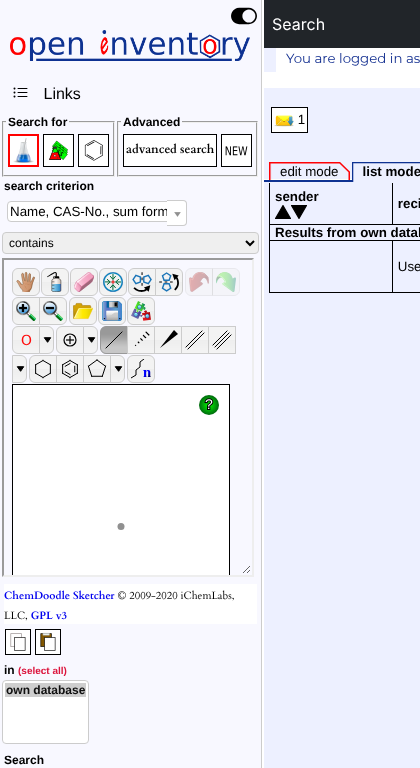 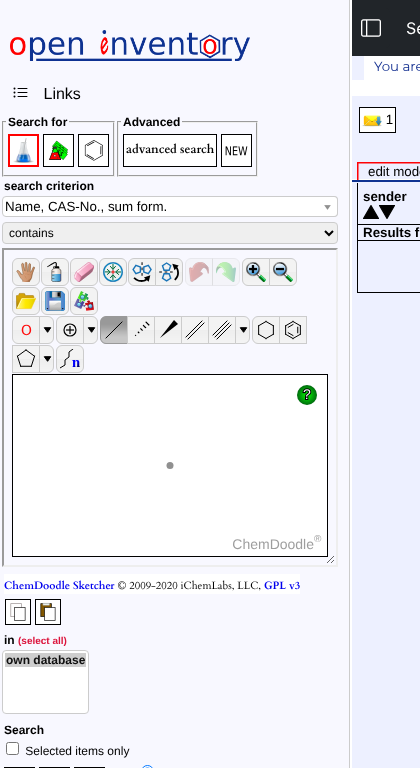

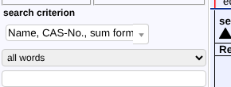 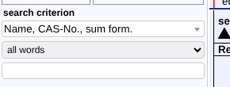

**From the lab's screenshot and screen recording** (both made before these fixes; sidebar about 290 px wide):

- **Recording.** In structure search, scrolling the sidebar down snaps back to the top within about a second, again and again. This is the structure-mode pin flicker fixed in `321f880`. With ChemDoodle: 0 backward jumps, 0 pin flips.
- **(a) Two vertical scrollbars, one inside ChemDoodle.**
  - Cause: the sketcher page (`sketcher.php`, quirks mode) was 417–421 px tall in its 319 px iframe: four toolbar rows plus a canvas of `innerHeight − 32`. With `resizable:true`, ChemDoodle also puts the canvas in a jQuery UI `.ui-wrapper` of fixed size. That makes a nested scroll area under the pointer.
  - Fix: in the sidebar, the sketcher is created without the resize handle. `fitSketcher()` sizes the canvas to the frame's width and to the height left under the toolbar, and fits it again whenever the frame changes size (wider sidebar for structure search, sidebar shown again).
  - Result: no scrollbar inside the sketcher at 262, 290 or 350 px (page = frame, 0 × 0 px overflow).
- **(b) Horizontal scrollbar.**
  - Cause: the canvas had a fixed width taken from the frame when it was created (e.g. 298 px), so in a narrower frame it overflowed sideways (310 px wide content in a 275 px frame at a 290 px sidebar).
  - The same fit fixes it. The sidebar page itself has no horizontal overflow at 262, 290 or 350 px.
- **(c) Criterion box and its arrow do not match.**
  - Cause: the scombobox's text field is an inline element, so its box comes out taller than the field (26 px against 21 px). The dropdown arrow is positioned at `height: 100%` of that box, so it ended up taller than the field and 1 px off (the lab saw a ~40×35 grey box next to a ~30 px field on Windows).
  - Fix: the field is now `display: block`, so the box is exactly as tall as the field and so is the arrow (field 256×21 at y 196, arrow 20×21 at y 196).
  - Criterion, operator and text box are 256 px wide, 21–22 px tall.

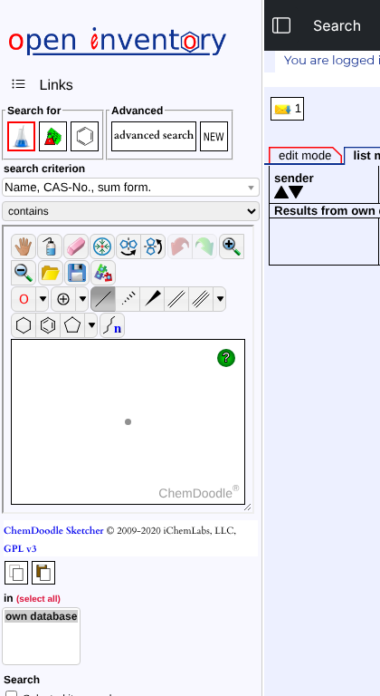

**Other checks:**
- The 100-run scroll sweep (text and structure search, now with ChemDoodle) still finds 0 runs with flicker.
- The sidebar button tests still pass, in the modern and classic UI.
- The classic UI gets the wider sidebar and the wheel fix, but not the width CSS. It shows no errors.
- No errors in any frame.
- **Not tested:** real Windows mouse wheels and touchpads. Headless Chromium has no visible scrollbar to drag, so dragging was simulated by setting the scroll position step by step.

## Risk

- **Bug 4: very low.** One class is removed, in the BS5-only branch of `topnav.php`.
- **Bug 3: low.**
  - `toggleSideframe()` is new, and only the sidenav toggle calls it.
  - `switchSideframe()` is still called the same way by the topnav links and by `»`. The only addition is a null-guarded icon swap.
  - The guard in the topnav listener only skips code that used to throw.
  - Edge case: if the user drags the sidenav wider or narrower without using the toggle, `cols` stays at its last scripted value. One click on the toggle then goes by that value: from the 35 px strip it always expands, otherwise it collapses. That is the expected behaviour.
- **Not covered by this test:** Firefox and Safari. Frameset `cols` handling is long-standing and the same in all engines.

## Effort

The prototype is done. Merging it into the work branch is a few minutes: cherry-pick the commit and re-run `php -l`. A manual check on the lab's server needs about 5 minutes: click the toggle a few times and look at the top-right links.

## Related findings (not fixed here)

The same merge (`1d5eb42`) dropped two more fork edits from `lib/sidenav.js`. Both should be reviewed separately:

1. **Structure search no longer widens the sidenav.** The fork's `expandWidth()` / `resetWidth()` set the sidenav to 350 px when "Structure" was picked as the search criterion. That code is gone.
2. **The date presets in the sidenav search are German-formatted again.** The presets (today, yesterday, this week, this month) call `getGerDate()`, which gives `d.m.yyyy`. The fork had changed them to `getSQLDate()`, which gives `yyyy-m-d`. This was not checked here against the new `date_format` setting or the server-side date parser.
